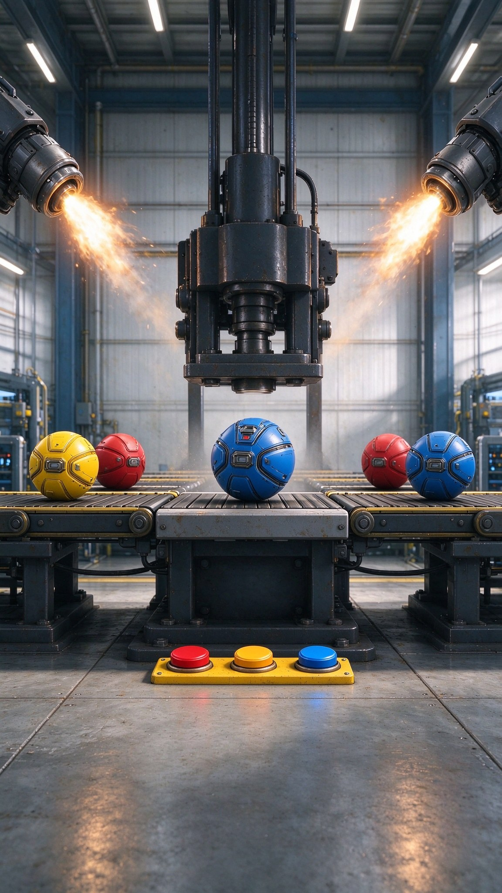

# 工厂地图（设计草案）

状态：仅记录设计方向与参考图，尚未实现，也未批准具体数值。指挥官于 2026-11-19 提出并要求先开 PR、不写代码。

## 参考图

参考图为场景气氛与布局依据：工业厂房、左右传送带上的机械篮球、画面中央的液压机、地面一组红黄蓝按钮，以及两侧喷射火焰的装填／发射装置。实现时按游戏视角与操作需要调整，不必逐像素还原。

## 主题

场景设定在工厂，组织邪恶机械篮球的生产。玩家仍要正常投篮得分，同时介入这条生产线：在正确时机按下对应颜色的按钮，把流水线上的机械篮球送进液压机销毁；来不及按下，篮球就会被送去装填发射器、激活并发射。

## 场景布置

- 背景是工厂传送带。
- 画面中间是液压机，用于压扁销毁机械篮球。
- 地面有三个按钮，对应红、黄、蓝三种颜色，用来把流水线上对应颜色的机械篮球送进液压机。
- 两侧可设置装填／发射装置，承接未能及时销毁、被送去激活的机械篮球。
- 传送带跟随鼓点运动。

## 核心规则

- 场上同一时间只会出现一个机械篮球。
- 必须及时按下正确颜色的按钮，才能把当前流水线上的机械篮球送进液压机销毁。
- 没来得及按下正确按钮时，该机械篮球会被送去装填发射器，随后激活并发射。
- 撞击机械篮球会使其昏厥；将其推进液压机里压扁，可获得奖励分。
- 常规进球得分仍然保留。

## 机械篮球

基础颜色为红、黄、蓝三种，之后也许加入复合颜色。当前已定的行为：

- **黄色**：横冲直撞，不停反弹。
- **红色**：放置悬浮地雷，碰到就炸飞。
- **蓝色**：会分裂，每瓣中间有红色激光连接；碰到激光就会蒸发。

复合颜色是否加入、以及加入后如何对应按钮，待后续讨论。

## 待讨论

以下内容指挥官尚未拍板，本草案不预设数值或实现方案：

- 按钮如何按下：用玩家的篮球踩中、点按，还是其他方式。
- “及时”的判定窗口，以及按错颜色按钮的后果。
- 按钮送入液压机，与撞击使其昏厥后再推进液压机，这两条销毁路径如何衔接。
- 奖励分的具体数值，以及是否影响连击或其他计分。
- 发射后的机械篮球如何运动、持续多久、如何离场或再被销毁。
- “蒸发”“炸飞”“昏厥”对玩家篮球、机械篮球和比分的具体影响。
- 复合颜色的出现条件，以及对应的按钮规则。
- 新的机械篮球在销毁或发射后何时再出现。
- 本图在经典、一分钟、肉鸽等模式中的启用范围，以及篮架位置与既有地图障碍的关系。
- 鼓点来源、传送带如何与节奏同步。

## 范围

本 PR 只加入本设计说明和参考图，不修改游戏代码，也不代表已批准实现、发布或合并。
